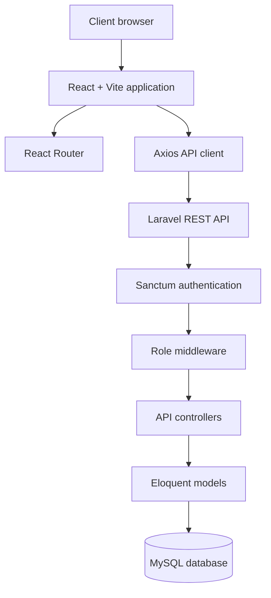

<p align="center">
  
</p>

<h1 align="center">Warshat</h1>

<p align="center">
  <strong>Home Maintenance Services Platform</strong><br />
  Discover service categories, explore services, and find experts by specialty.
</p>

<p align="center">
  
  
  
  
  
  
</p>

---

## Overview

Warshat is a home-maintenance services platform built as a full-stack application. It combines a client-facing web interface with a Laravel REST API. Clients can register and sign in, browse service categories, explore the services within a category, and discover experts associated with a service. Authenticated client and expert profile operations are protected by role-aware API middleware.

The repository is a **monorepo** containing two applications:

- **Backend:** Laravel 12 REST API, Laravel Sanctum token authentication, role middleware, Eloquent models, and MySQL configuration.
- **Frontend:** React 19 and TypeScript single-page application built with Vite and React Router.

## Core Features

### Client experience

- Client registration, login, and logout.
- Browse service sections and the services within each section.
- Search for service sections from the home screen.
- Browse experts and view experts associated with a selected service.
- View expert information through the frontend profile dialog.
- View and update the authenticated client's profile.

### Expert and account APIs

- Sanctum bearer-token authentication.
- Role-based route protection for client and expert endpoints.
- Expert profile retrieval and update endpoints.
- Expert-to-service association through the expert profile.

### Interface

- Arabic-first, right-to-left user interface.
- Cairo font integration.
- Reusable React pages and UI components.
- Animated page transitions and toast notifications.

> **Current scope:** The API routes currently cover authentication, client and expert profiles, service-section browsing, service details, and expert discovery. Booking, appointment scheduling, and payment APIs are not present in the current route definitions and are not represented as implemented features.

## Architecture



During local development, the Vite development server proxies `/api` requests to the Laravel server at `http://127.0.0.1:8000`.

## Repository Structure

```text
Warshat/
├── README.md
├── docs/
│   └── functional-requirements.md
├── warshat-app-back-end/
│   ├── app/
│   │   ├── Http/Controllers/
│   │   ├── Http/Middleware/
│   │   └── Models/
│   ├── bootstrap/
│   ├── config/
│   ├── database/
│   │   ├── migrations/
│   │   ├── factories/
│   │   └── seeders/
│   ├── routes/api.php
│   ├── tests/
│   ├── .env.example
│   ├── artisan
│   └── composer.json
└── warshat-app-front-end/
    ├── public/
    ├── src/
    │   ├── assets/
    │   ├── components/
    │   ├── lib/
    │   ├── pages/
    │   ├── store/
    │   ├── styles/
    │   └── utils/
    ├── .env.example
    ├── package.json
    └── vite.config.ts
```

## Technology Stack

| Area | Technologies |
|---|---|
| Backend framework | Laravel 12, PHP 8.2+ |
| API authentication | Laravel Sanctum |
| Backend data layer | Eloquent ORM |
| Database | MySQL (configured in `.env.example`) |
| Frontend framework | React 19, TypeScript 5.9 |
| Development and build | Vite 7 |
| Routing | React Router DOM 7 |
| Client state | Zustand 5 |
| API requests | Axios |
| Query infrastructure | TanStack Query 5 (QueryClient provider configured) |
| Forms and validation libraries | React Hook Form, Zod, `@hookform/resolvers` |
| UI and styling | Tailwind CSS 4, Radix UI, Lucide React |
| Motion and notifications | Framer Motion, Sonner, React Hot Toast |
| Backend tests | PHPUnit through Laravel's test runner |
| Frontend checks | ESLint, TypeScript compilation, Vite build |

## Getting Started

### Prerequisites

- PHP 8.2 or later.
- Composer.
- Node.js and npm.
- MySQL.

### 1. Clone the repository

```bash
git clone https://github.com/omarMAS202/Warshat.git
cd Warshat
```

### 2. Configure and run the backend

Open a terminal in the backend directory:

```bash
cd warshat-app-back-end
composer install
```

Create the local environment file:

```bash
# Windows PowerShell
Copy-Item .env.example .env

# macOS / Linux
cp .env.example .env
```

Generate the application key:

```bash
php artisan key:generate
```

Create a MySQL database named `warshat`. The supplied `.env.example` uses the following local database settings; change the username or password to match your MySQL installation:

```env
DB_CONNECTION=mysql
DB_HOST=127.0.0.1
DB_PORT=3306
DB_DATABASE=warshat
DB_USERNAME=root
DB_PASSWORD=
```

Run database migrations:

```bash
php artisan migrate
```

Optional: seed local demo data (sample users, sections, services, and expert profiles):

```bash
php artisan db:seed
```

> The seeder creates demo accounts with the password `password`. These credentials are for local development only. Never use demo credentials or seeded accounts in a public or production environment.

Start the Laravel API:

```bash
php artisan serve
```

The API will be available at `http://127.0.0.1:8000` and API routes use the `/api` prefix.

For backend-specific setup and implementation notes, see [Backend Documentation](warshat-app-back-end/README.md).

### 3. Configure and run the frontend

Open a **second terminal** from the repository root:

```bash
cd warshat-app-front-end
npm install
npm run dev
```

Open the local URL printed by Vite (normally `http://localhost:5173`).

The frontend API client defaults to `/api`, and the Vite development server proxies `/api` to `http://127.0.0.1:8000`. The optional `VITE_API_BASE_URL` variable can override the API base URL; see [`.env.example`](warshat-app-front-end/.env.example).

For frontend-specific setup and implementation notes, see [Frontend Documentation](warshat-app-front-end/README.md).

## Frontend Routes

The current React Router configuration defines the following routes:

| Route | Page |
|---|---|
| `/` | Login |
| `/register` | Client registration |
| `/home` | Home screen |
| `/services` | Service sections |
| `/services/:id` | Services within a section |
| `/service/:id/experts` | Experts associated with a service |
| `/about` | About page |
| `/contact` | Contact page |
| `/logout` | Logout flow |
| `*` | Redirects to the login page |

## API Reference

The endpoints below are registered in `warshat-app-back-end/routes/api.php`.

### Public endpoints

| Method | Endpoint | Description |
|---|---|---|
| `POST` | `/api/register` | Register a client account |
| `POST` | `/api/login` | Authenticate and issue a Sanctum token |

### Authenticated endpoints

All routes below require a valid Sanctum bearer token and the indicated role.

| Method | Endpoint | Access | Description |
|---|---|---|---|
| `POST` | `/api/logout` | Authenticated | Revoke the authenticated user's tokens |
| `GET` | `/api/client/profile` | Client | Retrieve the client profile |
| `PUT` | `/api/client/profile` | Client | Update the client profile |
| `GET` | `/api/experts` | Client | List experts; supports an optional `service_id` filter |
| `GET` | `/api/experts/{id}` | Client | Retrieve an expert and their expert profile |
| `GET` | `/api/sections` | Client | List service sections |
| `GET` | `/api/sections/{section}` | Client | Retrieve a section with its services |
| `GET` | `/api/services/{id}` | Client | Retrieve service information and associated experts |
| `GET` | `/api/expert/profile` | Expert | Retrieve the authenticated expert profile |
| `PUT` | `/api/expert/profile` | Expert | Update expert and expert-profile details |

### Authentication header

Protected requests use the token returned by `/api/login` or `/api/register`:

```http
Authorization: Bearer <access_token>
Accept: application/json
```

The frontend Axios client automatically attaches the token stored in browser `localStorage` to API requests.

## Data Model

The current Eloquent models and migrations define these main entities and relationships:

- **User:** account details and role (`admin`, `expert`, or `client`).
- **ExpertProfile:** belongs to a user and can be associated with a service.
- **Section:** contains multiple services.
- **Service:** belongs to a section.

The API currently defines role-protected route groups for `client` and `expert`. Although `admin` exists as a user role and is created by the demo seeder, an admin API route group is not defined in the current `routes/api.php` file.

## Testing and Quality Checks

### Backend

Run the Laravel test suite from the backend directory:

```bash
php artisan test
```

The repository includes feature tests for authentication validation, logout authentication/token revocation, and client access to section endpoints, plus the default Laravel example tests.

### Frontend

Run the available frontend checks from the frontend directory:

```bash
npm run lint
npm run build
```

The frontend `package.json` defines `dev`, `build`, `lint`, and `preview` scripts. It does not currently define a dedicated `test` script.

## Current Scope and Known Limitations

- Client registration assigns the `client` role by default.
- Access control uses Sanctum authentication and the custom role middleware.
- The frontend stores its access token in `localStorage` and sends it as a Bearer token through an Axios request interceptor.
- The current API includes service and expert discovery endpoints, but not booking, appointment, or payment routes.
- The current `GET /api/expert/profile` controller implementation should be corrected before relying on that endpoint: it currently attempts to call `load()` on the JSON response instead of loading the relationship on the user model first.
- The `store`, `update`, and `destroy` methods in the section/service controllers are placeholders and are not registered as API routes in the current `routes/api.php` file.

## Functional Requirements

See [`docs/functional-requirements.md`](docs/functional-requirements.md) for the concise client-facing feature checklist retained from the project files.

---

<p align="center"><sub>Warshat — Home Maintenance Services Platform</sub></p>
