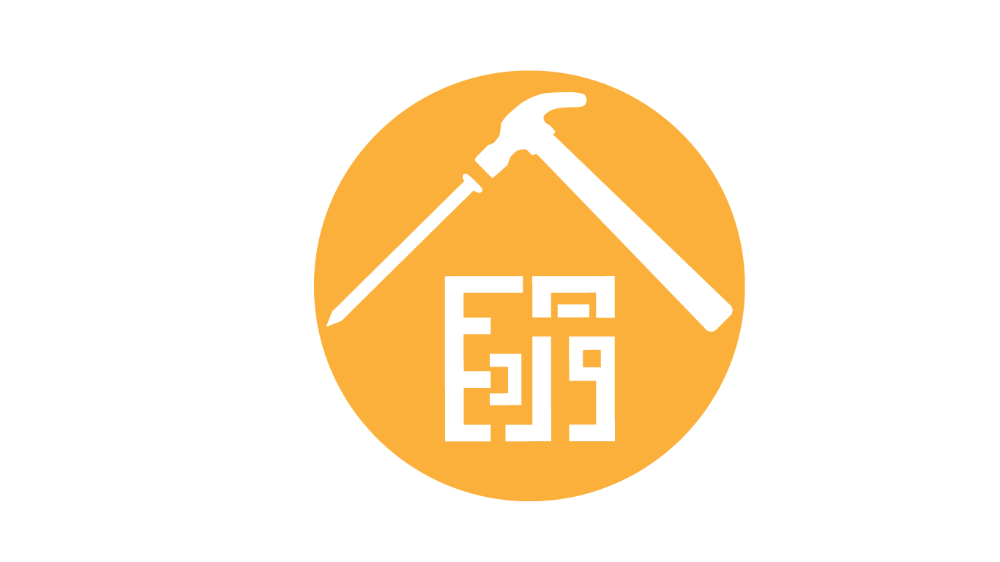
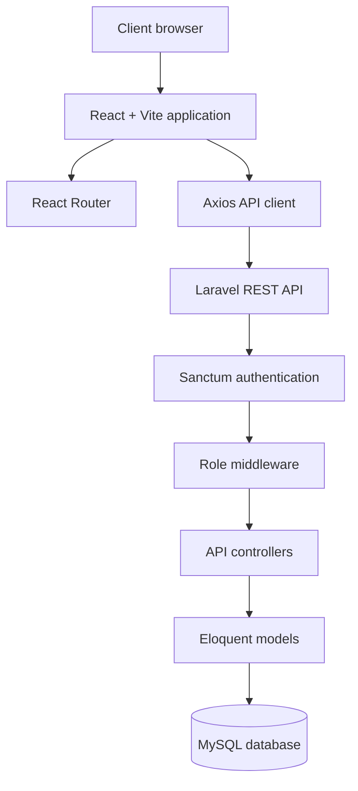

<p align="center">
  
</p>

<h1 align="center">Warshat</h1>

<p align="center">
  <strong>Home Maintenance Services Platform</strong><br />
  Discover service categories, explore available services, and find experts by specialty.
</p>

<p align="center">
  
  
  
  
  
  
</p>

---

## Overview

Warshat is a home-maintenance services platform built around a client-facing web application and a Laravel REST API. Clients can create an account, browse service categories, explore the services within each category, and discover experts associated with a service. Client and expert profile operations are handled through role-protected API endpoints.

The repository is organized as a **monorepo** containing two applications:

- **Backend:** Laravel 12 REST API, Sanctum token authentication, role middleware, and Eloquent models.
- **Frontend:** React 19 single-page application built with Vite, React Router, and TypeScript.

## Core Features

### Client experience

- Client registration, login, and logout.
- Browse service sections and the services within each section.
- Search sections from the home screen.
- Browse experts and view experts associated with a selected service.
- View expert details through the frontend profile dialog.
- View and update the authenticated client's profile.

### Expert and account APIs

- Sanctum bearer-token authentication.
- Role-based route protection for client and expert endpoints.
- Expert profile retrieval and update endpoints.
- Expert-to-service association through the expert profile.

### Interface

- Arabic-first, right-to-left layout.
- Cairo font integration.
- Reusable React pages and UI components.
- Toast notifications and animated page transitions.

> **Current scope:** The routes in this repository cover authentication, profiles, service discovery, and expert discovery. Booking, appointment scheduling, and payment endpoints are not present in the current API routes and are therefore not described as implemented features here.

## Application Architecture



During local development, the Vite development server proxies requests from `/api` to the Laravel server at `http://127.0.0.1:8000`.

## Repository Structure

```text
Warshat/
├── warshat-app-back-end/
│   ├── app/
│   │   ├── Http/
│   │   │   ├── Controllers/
│   │   │   └── Middleware/
│   │   ├── Models/
│   │   └── Providers/
│   ├── bootstrap/
│   ├── config/
│   ├── database/
│   │   ├── migrations/
│   │   ├── factories/
│   │   └── seeders/
│   ├── routes/
│   │   └── api.php
│   ├── tests/
│   ├── .env.example
│   ├── artisan
│   └── composer.json
│
└── warshat-app-front-end/
    ├── public/
    ├── src/
    │   ├── assets/
    │   ├── components/
    │   ├── lib/
    │   ├── pages/
    │   ├── store/
    │   ├── styles/
    │   └── utils/
    ├── package.json
    ├── vite.config.ts
    └── tsconfig.json
```

## Technology Stack

| Area | Technologies |
|---|---|
| Backend framework | Laravel 12, PHP 8.2+ |
| API authentication | Laravel Sanctum |
| Backend data layer | Eloquent ORM |
| Database configuration | MySQL (as configured in `.env.example`) |
| Frontend framework | React 19, TypeScript 5.9 |
| Development/build tool | Vite 7 |
| Routing | React Router DOM 7 |
| Client state | Zustand 5 |
| API requests | Axios |
| Query infrastructure | TanStack Query 5 (QueryClient provider configured) |
| Forms and validation | React Hook Form, Zod, `@hookform/resolvers` |
| UI and styling | Tailwind CSS 4, Radix UI, Lucide React |
| Motion and notifications | Framer Motion, Sonner, React Hot Toast |
| Backend tests | PHPUnit via Laravel's test runner |
| Frontend checks | ESLint, TypeScript build, Vite build |

## Getting Started

### Prerequisites

Install the following tools before setting up the project:

- PHP 8.2 or later.
- Composer.
- Node.js and npm.
- MySQL.

### 1. Clone the repository

```bash
git clone https://github.com/omarMAS202/Warshat.git
cd Warshat
```

If the repository has a different name or URL in your GitHub account, use its current clone URL.

### 2. Configure and run the backend

Open a terminal in the backend directory:

```bash
cd warshat-app-back-end
composer install
```

Create the local environment file:

```bash
# macOS / Linux
cp .env.example .env

# Windows PowerShell
Copy-Item .env.example .env
```

Generate the Laravel application key:

```bash
php artisan key:generate
```

Create a MySQL database named `warshat`, then check the database values in `.env`. The supplied `.env.example` uses these defaults:

```env
DB_CONNECTION=mysql
DB_HOST=127.0.0.1
DB_PORT=3306
DB_DATABASE=warshat
DB_USERNAME=root
DB_PASSWORD=
```

Update the username and password to match your local MySQL installation.

Run the migrations:

```bash
php artisan migrate
```

Optional: load the sample sections, services, and demo accounts for local development:

```bash
php artisan db:seed
```

> The seeder creates demo accounts with a default password of `password`. Use seeded accounts only in a local development database. Do not run the demo seeder in production, and never reuse its credentials in a deployed environment.

Start the API server:

```bash
php artisan serve
```

The Laravel API is available at `http://127.0.0.1:8000` and API routes use the `/api` prefix.

### 3. Configure and run the frontend

Open a **second terminal** from the repository root:

```bash
cd warshat-app-front-end
npm install
npm run dev
```

Open the Vite URL printed in the terminal (Vite normally uses `http://localhost:5173`).

The frontend Axios client uses `/api` by default, and `vite.config.ts` proxies `/api` requests to `http://127.0.0.1:8000`. For a different API host, define `VITE_API_BASE_URL` in a local `.env` file, for example:

```env
VITE_API_BASE_URL=http://127.0.0.1:8000/api
```

When using a separately hosted frontend and backend, configure the backend's CORS policy to allow the frontend origin.

## Frontend Routes

The current React Router configuration defines these routes:

| Route | Page |
|---|---|
| `/` | Login |
| `/register` | Client registration |
| `/home` | Home screen |
| `/services` | Service sections |
| `/services/:id` | Services within a section |
| `/service/:id/experts` | Experts associated with a service |
| `/about` | About page |
| `/contact` | Contact page |
| `/logout` | Logout flow |
| `*` | Redirects to the login page |

## API Reference

All endpoints below are registered in `warshat-app-back-end/routes/api.php`. Protected endpoints require a valid Sanctum bearer token and the role indicated in the table.

### Public endpoints

| Method | Endpoint | Description |
|---|---|---|
| `POST` | `/api/register` | Register a client account |
| `POST` | `/api/login` | Authenticate and issue an access token |

### Authenticated endpoints

| Method | Endpoint | Access | Description |
|---|---|---|---|
| `POST` | `/api/logout` | Authenticated | Revoke the user's tokens |
| `GET` | `/api/client/profile` | Client | Retrieve the client profile |
| `PUT` | `/api/client/profile` | Client | Update the client profile |
| `GET` | `/api/experts` | Client | List experts; accepts optional `service_id` filter |
| `GET` | `/api/experts/{id}` | Client | Retrieve an expert and their profile |
| `GET` | `/api/sections` | Client | List service sections |
| `GET` | `/api/sections/{section}` | Client | Retrieve a section with its services |
| `GET` | `/api/services/{id}` | Client | Retrieve service information and associated experts |
| `GET` | `/api/expert/profile` | Expert | Retrieve the expert profile |
| `PUT` | `/api/expert/profile` | Expert | Update expert and expert-profile details |

### Authentication header

For protected requests, send the token returned by `/api/login` or `/api/register`:

```http
Authorization: Bearer <access_token>
Accept: application/json
```

The frontend Axios client automatically attaches the token stored in browser `localStorage` to API requests.

## Data Model

The current Eloquent models and migrations define these main relationships:

- **User:** stores account details and a role (`admin`, `expert`, or `client`).
- **ExpertProfile:** belongs to a user and can be associated with a service.
- **Section:** contains multiple services.
- **Service:** belongs to a section.

The API currently defines role-protected route groups for `client` and `expert`. Although `admin` is present in the user role enum and demo seeder, an admin API route group is not defined in the current `routes/api.php` file.

> **Endpoint review note:** `GET /api/expert/profile` is registered, but the current `ExpertController::profile()` implementation calls `load()` on a JSON response rather than on the user model. Review that method before relying on this endpoint.

## Testing and Quality Checks

### Backend

Run the Laravel test suite from the backend directory:

```bash
php artisan test
```

The included feature tests cover authentication validation, logout authentication/token revocation, and client access to section endpoints.

### Frontend

Run the available frontend checks from the frontend directory:

```bash
npm run lint
npm run build
```

The frontend `package.json` currently defines `dev`, `build`, `lint`, and `preview` scripts; it does not define a dedicated `test` script.

## Implementation Notes

- Client registration assigns the `client` role by default.
- Access control is enforced by Sanctum authentication and the custom `role` middleware.
- The frontend stores the access token in `localStorage` and sends it as a Bearer token through an Axios request interceptor.
- The Vite development proxy is configured for local API requests; production deployments need an appropriate API URL and CORS configuration.
- The current API includes service and expert discovery endpoints, but not booking, appointment, or payment routes.

---

<p align="center">
  <sub>Warshat — Home Maintenance Services Platform</sub>
</p>
